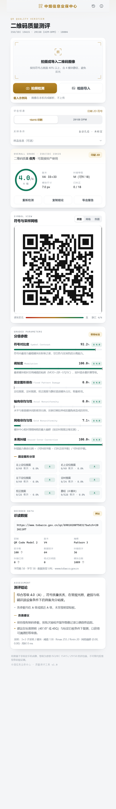
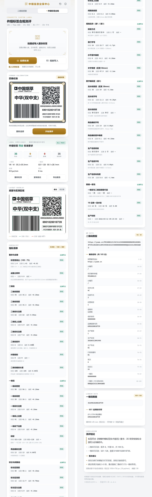

# 二维码质量测评 · 中烟信息业保中心

移动端卷烟质量测评工具，两个相互独立的测评页：

1. **二维码质量**：拍照或导入图片后给出分级参数、识读数据与中文测评结论，分级逻辑参照 ISO/IEC 15415、ISO/IEC 29158（AIM-DPM）与 ISO/IEC 18004。
2. **件烟标签合规**：按《卷烟件烟标签技术规范》以 105×75mm 为基准，量测二维码、一维码、标志、间隔线、规格名称与数字编码区的位置、尺寸与字号，逐项对照表1/表2/表3 并给出**偏差值与中文结论**，同时展示标签内二维码与一维码的数据。



## 仓库与在线版本

```
https://github.com/closerose-Tech/qrcode-c
```

| 用途 | 地址 / 方式 |
| --- | --- |
| 网页版（手机可直接用） | https://closerose-tech.github.io/qrcode-c/ |
| 安卓安装包（直链） | [qr-quality-verifier-1.0.1.apk](https://github.com/closerose-Tech/qrcode-c/releases/download/v1.0.1/qr-quality-verifier-1.0.1.apk) |
| 每次构建的临时产物 | Actions → **Android APK** → 对应运行 → Artifacts |
| 本地提交 | `git push`（凭据由 Git Credential Manager 保存） |

两条流水线在 `.github/workflows/`：`android.yml` 用 runner 预装 SDK + JDK 17 + Gradle 8.7 构建 Debug APK 并上传产物；`pages.yml` 把 `app/` 发布为静态站点（Pages 源已设为 GitHub Actions）。

网页版首次打开后可「添加到主屏幕」按 PWA 全屏运行，首屏加载完即完全离线可用。

## 目录

```
app/                      可直接部署的网页应用（PWA，可离线）
  index.html
  assets/css/app.css      视觉系统
  assets/js/app.js        交互层
  assets/js/core/         测评引擎
    img.js                灰度、缩放、双线性采样、对比度拉伸
    qrstruct.js           格式信息 BCH、功能图形、码字读取、RS 纠错计数
    rsblocks.js           纠错块结构表（v1–v40）
    qrgrade.js            网格校准、反射率采样、七参数分级、结论生成
    code128.js            Code 128 / GS1-128 解码与编码（自研，含模 103 校验与 AI 解析）
    label.js              件烟标签量测引擎：四角检出、透视校正、区域/字号量测、合规判定
  assets/js/labelui.js    标签页交互层：四角校准画布、测评流程、指标清单与结论渲染
  assets/js/vendor/       jsQR 1.4（识读定位）、qrcode-generator（示例码/结构表）
android/                  Android Studio 工程（WebView 外壳，资源见 assets/web）
tools/test.js             合成用例验证脚本（node tools/test.js）
tools/make-fixtures.py    标签灰度样本生成（标准/透视/二维码缩尺/字号偏差/低分辨率）
tools/test-label.js       标签测评端到端断言（node tools/test-label.js）
docs/preview.png          整页预览
```

## 运行

**浏览器 / 手机浏览器（推荐先用这个）**

```bash
cd app
python -m http.server 8899
# 打开 http://localhost:8899
```

手机浏览器访问同一局域网地址即可拍照检测；Chrome 菜单「添加到主屏幕」后按 PWA 全屏运行。首屏加载后完全离线可用。

**Android 应用（APK）**

用 Android Studio 打开 `android/`，首次打开会自动生成 Gradle Wrapper，直接 Run 或 Build APK。
`app/` 会在构建前自动同步到 `android/app/src/main/assets/web`（`syncWebAssets` 任务），无需手工复制。
外壳使用 `WebViewAssetLoader`（`https://appassets.androidplatform.net`）加载资源，避免 `file://` 造成的画布污染。

「拍照检测」在应用内**直接取景**（`getUserMedia` + `<video>` 抓帧），而不是退化成文件选择器的 `<input capture>`。WebView 的摄像头需要同时满足两件事，`MainActivity` 已实现：清单声明 `CAMERA` 运行时权限；`WebChromeClient.onPermissionRequest` 对 `RESOURCE_VIDEO_CAPTURE` 显式授予。授权结果通过 `window.onCameraPermission(granted)` 回传页面，未授权时自动回退系统相机 / 相册导入。应用不申请联网权限，图像不出本机。

**演示参数**：`?demo=1`（自动载入示例）、`?demo=2`（模糊+低对比示例）、`&std=29158`（DPM 模式）、`&view=heat`（热图）、`?view=label&demo=label`（直开标签页并跑示例标签）。

## 发布版本

正式包由 `Release APK` 流水线产出（`.github/workflows/release.yml`），产物是**正式签名的 release APK**，同时创建 GitHub Release：

```bash
# 方式一：网页 Actions → Release APK → Run workflow，填版本号（如 1.0.1）
# 方式二：打 tag 自动触发
git tag v1.0.1 && git push origin v1.0.1
```

版本号写入 `versionName`，`versionCode` 按 `主*10000+次*100+修订` 自动换算；`app/index.html` 里的 `app-version` 会在构建时同步，界面底部显示的就是包内版本。

**签名密钥（重要）**：首次运行若仓库未配置 Secrets，流水线会临时生成密钥并把 `release-keystore` 作为产物上传。请下载后配置以下 Secrets，否则下一个版本签名不同，用户必须先卸载才能安装：

| Secret | 内容 |
| --- | --- |
| `KEYSTORE_BASE64` | `base64 -w0 release.keystore` 的输出 |
| `KEYSTORE_PASSWORD` | keystore 口令 |
| `KEY_ALIAS` | 别名（默认 `qrverify`） |

本地构建只需把 `android/keystore.properties.example` 复制为 `android/keystore.properties` 并填好路径与口令，`gradle assembleRelease` 即用该密钥签名（该文件与 `*.jks` 不入库）。

## 测评了什么

| 参数 | 说明 | 计算方式 |
| --- | --- | --- |
| 识读 Decode | 能否解出码字 | jsQR 多策略识读（原图 / 对比度拉伸 / 全分辨率，含反相） |
| 符号对比度 SC | Rmax−Rmin | 各模块反射率的高/低 10% 均值之差 |
| 调制度 MOD | 2\|R−GT\|/SC | 5×5 子采样取最差模块，再按纠错余量折算等级 |
| 固定图形损伤 FPD | 定位/定时/校正图案与静区的错误模块占比 | 由版本生成期望图案逐模块比对，取最差分项 |
| 轴向非均匀性 AN | \|X−Y\|/((X+Y)/2) | 四边形四边反算水平/垂直模块间距 |
| 网格非均匀性 GN | 模块中心对理想网格的最大偏移 | 定时图案边缘亚像素扫描实测 |
| 未用纠错 UEC | (可纠−已纠正)/可纠 | **逐块 Reed-Solomon 解码实测**，非估算 |

DPM 模式（29158）改以反射率分布统计阈值计算**单元对比度 CC**、**单元调制度 CM**、**最小反射率 MR**，并给出**分布性损伤 DDG**；其余参数沿用。

整体等级取各参数最低值（可输出一位小数，对应 15415:2024 的连续分级），识读失败直接判 F。

报告同时给出：版本、纠错等级、掩模号、码字结构、已纠正码字数、符号尺寸、模块像素、静区实测宽度、反射率极值、格式信息汉明距、图像清晰度等。

## 件烟标签合规测评




参照《卷烟件烟标签技术规范》，以 **105×75mm** 标签为基准。先由标签四角做透视校正，再用二维码（标准 35×35mm）的实际像素边长反推 `px/mm`，进而在校正图上量测各区域。

| 区域 | 标准位置与尺寸（mm） | 判据来源 |
| --- | --- | --- |
| 标志区 | 6, 6 · 50×12 | 表2 |
| 间隔线 | 6, 18.4 · 50×0.2 | 表2 |
| 规格名称 | 6, 20.4 · 50×17 | 表1 / 表2 |
| 一维码 | 6, 41 · 50×28 | 表2 |
| 二维码 | 62, 6 · 35×35（右边距 8） | 表2 |
| 数字编码区 | x=61 起，宽 38 | 表2 / 表3 |

字号按表3 反算（1pt = 0.3528mm）：规格名称首行 24pt、次行 20pt（≤7 汉字）或 14pt；流水码 11pt；商品编码 14pt；生产信息 11pt。CJK 字面高按 ≈0.88em、数字 ≈0.72em、数字步进 ≈0.55em 换算，同时校验行数（单行/双行居中）、水平居中偏差、文字区宽度与行块高度。

共 35 项受检指标，分 7 组：整体与成像、二维码、一维码、标志与间隔线、规格名称、数字编码区、数据一致性。每项输出「标准 − 实测 = 偏差」，偏差在容差内为**符合**、1.6 倍容差内为**临界**、超出为**超差**；超差项在清单与叠加图中以红色突出（临界为琥珀色），末尾给出中文结论与整改建议。

同时解析并展示标签内容：二维码 105 位编码结构（网络服务地址 / 标识解析前缀 / 实体分类 / 包装方式 / 经营类型 / 规格码 / 组织机构 / 品牌规格代码 / 生产类型 / 生产时间 / 生产车间 / 打码机编号 / 班次 / 自定义 / 一维码 / 18 位流水码）与一维码 GS1-128 数据（AI 解析 + 模 103 校验），并交叉核对一维码与二维码的规格代码是否一致。

## 精度说明

- 纠错计数经过自检：版本 2-H（单块）人为损坏 1/2/3/4/6 个码字，检出数分别为 1/2/3/4/6，干净图像为 0。
- 几何链路覆盖旋转 7°、透视 12%、旋转+透视组合，等级与识读结果均正确。
- 手机成像没有标定光源与标准孔径，反射率为相对值；等级用于来料比对、批次趋势与工艺排查，**不能替代校准型验证器**。正式验收请在 45°/0° 照明与标定白板条件下复测。

## 当前版本边界

- 完整分级针对 QR Code（Model 2）；Micro QR、Data Matrix（16022）、一维条码（15416）的专用解码与分级尚未开放，已在应用内「标准说明」中注明。
- 流水线产出的是 **debug 签名** APK，适合内部试用；对外分发前请在仓库 Secrets 配 release keystore 并改用 `assembleRelease`。
- 标签合规测评依赖整张标签清晰入画；校正后低于 8px/mm 时，11pt 字号与 0.2mm 间隔线宽的量测误差明显增大，界面会在「成像分辨率」项给出提示。
- 标签版式以文档给定的 105×75mm 为唯一基准，其他幅面（如异形标）需按同比例换算后使用。
- 拍照由应用内取景或系统相机完成，曝光/白平衡不受控；对高反光金属、曲面等场景建议改用 29158 模式评估趋势。

## 验证

```bash
node tools/test.js
```

合成 14 个场景（理想、低对比、三档模糊、噪声、光照渐变、小尺寸、反相、静区不足、DPM、旋转、透视、旋转+透视），输出各参数与等级，并把图像写到 `tools/out/` 便于人工核对。

```bash
python tools/make-fixtures.py   # 生成标签灰度样本
node tools/test-label.js        # 标签测评端到端断言
```

标签样本覆盖：标准标签、旋转 4°+透视 9%、二维码缩至 29mm、规格名 18pt 且一维码缩尺、低分辨率 6px/mm。断言「标准标签全部符合」「人为偏差项必须被判为超差/临界」，全部用例通过。
